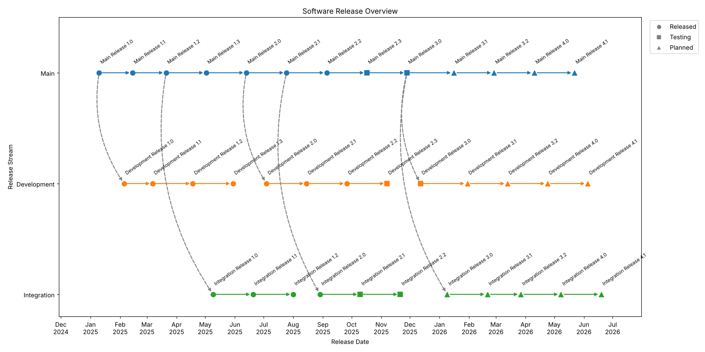
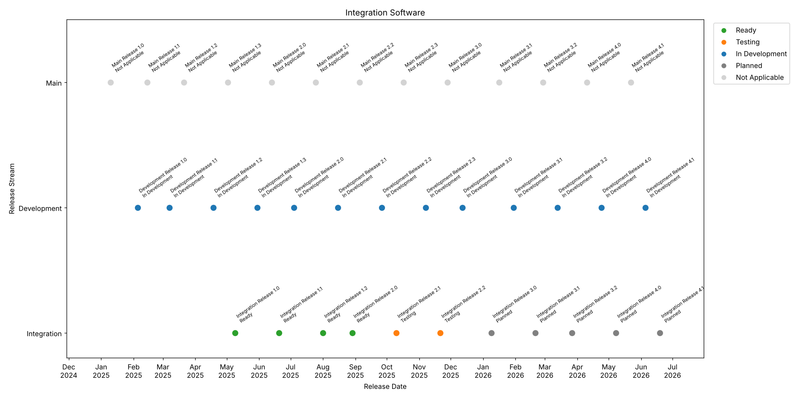

# Software Release Visualiser

[](https://github.com/amfernandes99/software-release-visualizer/actions/workflows/ci.yml)

A Python tool that combines software release data from several sources and turns it into a PDF report, showing how releases progress across development streams and where the streams branch from each other.




## Background

This project is a recreation of a release visualisation tool I owned in my role at an automotive manufacturer. The original used the RTCClient Python library to pull release data from RTC by IBM (the release platform used at the company) and produced a PDF report, which I then presented to senior managers and colleagues with a less technical background.

I took over the tool in 2024, nearly a year after the graduate who built it had left. By then it no longer ran: the RTC server URLs, project areas and saved query IDs it relied on were out of date. There were access issues to resolve, and it could no longer produce its report. I worked out the correct reports and queries by digging through RTC, meeting the release engineers who used the data, and testing queries until the results matched. I then fixed authentication with the RTC server and refactored the code so it could be maintained.

This version was rebuilt from scratch with fictional data. It keeps the parts of the original that mattered - combining several reports into one view, choosing the most reliable date for each release and showing where streams branch - in a simpler, tested form.

## What it does

- Reads four CSV files, each standing in for a separate report from the original tool, and joins them by release ID.
- Picks the most reliable date for each release: the received date if the software has arrived, otherwise the forecast date, otherwise the original due date.
- Checks the data as it loads and stops with a clear message if something is wrong, such as an unknown stream, a duplicate release ID or a link to a release that doesn't exist.
- Generates a four-page PDF report.

## Report pages

1. **Software Release Overview** - each stream has its own lane. Arrows link each release to the next, and links between streams are grey, dashed and curved so the branches stand out. Marker shape shows whether a release is released, in testing or planned.
2. **Defects, Changes and Testing** - defect, change and test counts for each release.
3. **Integration Software** - integration status for each release, colour coded.
4. **Core Components** - the component version in each release.



An example report generated from the sample data is included: [`software_release_report.pdf`](software_release_report.pdf)

## Data

| File | Contents |
|---|---|
| `releases.csv` | One row per release: ID, name, stream, status, received/forecast/due dates and component version |
| `relationships.csv` | Parent-child links between releases |
| `quality.csv` | Defect, change and test counts |
| `integration.csv` | Integration status |

All of the data is fictional.

## Running it

Requires Python 3.12 or later.

```
pip install -r requirements.txt
python src/main.py
```

The report is saved as `software_release_report.pdf` in the project folder. To use a different data folder or output file:

```
python src/main.py --data-dir path/to/data --output my_report.pdf
```

## Tests

```
pytest
```

The tests cover the date priority rule, loading the sample data and rejecting bad data. They run automatically on every push using GitHub Actions.

I formatted the code with [Black](https://github.com/psf/black).

## Project structure

```
src/
  main.py              Entry point - loads the data and builds the PDF
  release_data.py      Reads, joins and validates the CSV files
  graph_functions.py   Draws each page of the report
  models.py            The Release class
data/                  Fictional sample data
tests/                 pytest tests
images/                Preview images for this README
```